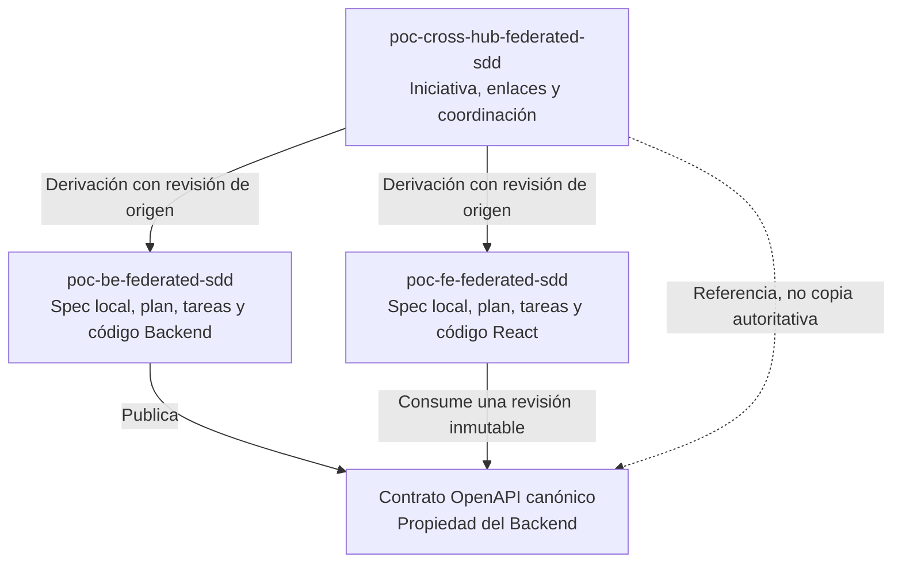
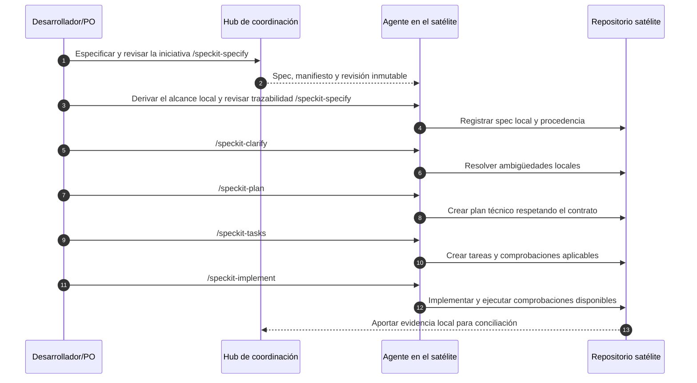

# PoC: Diseño inicial de PoC para implementar Initiative-First SDD con Spec Kit federado

## Estado y objetivo

**Estado:** borrador de arquitectura y diseño. Las estructuras, los metadatos de derivación
y las automatizaciones descritas son propuestas; no constituyen funcionalidades implementadas.

El objetivo es validar el modelo federado en un ecosistema polyrepo con GitHub Spec Kit:
una iniciativa transversal vive en el Hub y cada repositorio satélite deriva su especificación
local, su plan técnico y sus tareas. Los contratos compartidos tienen un propietario explícito
y referencias a revisiones inmutables.

Este documento desarrolla el modelo descrito en [AGENTS.md](../AGENTS.md) y está subordinado
a la [constitución del Hub](../.specify/memory/constitution.md). No sustituye a la futura
especificación de la iniciativa ni modifica las constituciones de los satélites.

## 1. Caso de uso de la PoC

> Añadir un endpoint `GET /health` que devuelva `{"status":"ok"}` y una página React
> que muestre el estado. El contrato OpenAPI debe reflejarlo.

Identificador propuesto de la iniciativa: `001-health-status`.

| ID | Requisito transversal | Responsable |
| --- | --- | --- |
| FR-001 | Exponer `GET /health` con respuesta HTTP 200 y cuerpo JSON `{"status":"ok"}`. | Backend |
| FR-002 | Definir la operación y su respuesta en el contrato OpenAPI canónico. | Backend |
| FR-003 | Consultar el endpoint desde una página React y mostrar el estado recibido. | Frontend |
| FR-004 | Diferenciar en la página los estados de carga, respuesta correcta y error de consulta. | Frontend |

FR-004 es una propuesta para completar el comportamiento de la interfaz y debe confirmarse
al especificar la iniciativa. No se presupone una tecnología Backend, una base de datos ni
un mecanismo de despliegue. Esta PoC no incluye un sistema completo de monitorización.

## 2. Topología y separación de planos



| Repositorio | Plano | Responsabilidad |
| --- | --- | --- |
| [poc-cross-hub-federated-sdd](https://github.com/dariopalminio/poc-cross-hub-federated-sdd) | Coordinación estratégica | Iniciativa, gobernanza del Hub, enlaces y estado transversal. |
| [poc-be-federated-sdd](https://github.com/dariopalminio/poc-be-federated-sdd) | Ejecución técnica | Endpoint, contrato OpenAPI, especificación local, plan, tareas y pruebas Backend. |
| [poc-fe-federated-sdd](https://github.com/dariopalminio/poc-fe-federated-sdd) | Ejecución técnica | Página React, consumo del contrato, especificación local, plan, tareas y pruebas Frontend. |

El Hub no contiene código de producto ni planes o tareas de implementación de los satélites.
Cada satélite mantiene su instalación de Spec Kit y sus decisiones técnicas locales, sin
redefinir unilateralmente el alcance transversal o contratos de otro propietario.

## 3. Estructura de archivos propuesta

Las siguientes rutas ilustran el estado objetivo; no afirman que esos archivos ya existan.

### Hub de coordinación

```text
poc-cross-hub-federated-sdd/
├── .specify/
│   └── memory/
│       └── constitution.md
├── docs/
│   ├── poc-borrador.md
│   └── template/
│       └── parent-spec-manifest-template.yaml
└── specs/
    └── 001-health-status/
        ├── spec.md
        └── parent-spec-manifest.yaml
```

La plantilla disponible es
[docs/template/parent-spec-manifest-template.yaml](template/parent-spec-manifest-template.yaml).
El manifiesto de la iniciativa debe identificar contratos y propietario; las referencias
inmutables y el mapeo de satélites siguientes son una propuesta de ampliación que deberá
validarse contra la plantilla antes de automatizar su consumo.

Ejemplo propuesto de manifiesto, con marcadores que deben sustituirse antes de usarlo:

```yaml
schema: spec-driven/links-manifest-template-v1
id: 001-health-status
title: Consulta y visualización del estado del servicio
shared_contracts:
  - id: health-api
    owner_repo: https://github.com/dariopalminio/poc-be-federated-sdd
    path: contracts/health-api.yaml
    revision: "<SHA_COMPLETO_DEL_COMMIT_DEL_CONTRATO>"
links:
  - role: backend-health
    repo: https://github.com/dariopalminio/poc-be-federated-sdd
    local_spec: specs/001-health-endpoint/spec.md
    scope:
      - FR-001
      - FR-002
  - role: frontend-health
    repo: https://github.com/dariopalminio/poc-fe-federated-sdd
    local_spec: specs/001-health-page/spec.md
    scope:
      - FR-003
      - FR-004
```

El contrato canónico reside en el Backend, no en un directorio de contratos del Hub.
Una rama mutable como `main` no identifica por sí sola la revisión consumida.

### Repositorios satélite

```text
poc-be-federated-sdd/
├── .specify/
│   └── memory/constitution.md
├── specs/
│   └── 001-health-endpoint/
│       ├── spec-origin.yaml
│       ├── spec.md
│       ├── plan.md
│       └── tasks.md
├── specs/contracts/openapi/
│   └── health-api.yaml
└── src/

poc-fe-federated-sdd/
├── .specify/
│   └── memory/constitution.md
├── specs/
│   └── 001-health-page/
│       ├── spec-origin.yaml
│       ├── spec.md
│       ├── plan.md
│       └── tasks.md
└── src/
```

Las rutas de código y pruebas se concretarán según las herramientas reales de cada satélite.
El Frontend referencia el contrato del Backend; no mantiene una definición autoritativa alternativa.

Ejemplo propuesto de metadatos de origen para el Backend:

```yaml
parent_spec_id: 001-health-status
hub_repo: https://github.com/dariopalminio/poc-cross-hub-federated-sdd
spec_source: specs/001-health-status/spec.md
source_revision: "<SHA_COMPLETO_DEL_COMMIT_DE_LA_INICIATIVA>"
role: backend-health
requirements:
  - FR-001
  - FR-002
```

Una fecha de sincronización puede aportar información adicional, pero no sustituye al SHA
de origen. El formato `spec-origin.yaml` propuesto no es una capacidad estándar confirmada de Spec Kit.

## 4. Derivación de la iniciativa/épica (spec padre) al satélite (spec hija)

La derivación debe conservar los requisitos aplicables y sus identificadores, sin resumir
de forma que se pierdan criterios de aceptación o dependencias compartidas.

1. Resolver el repositorio del Hub, la ruta de la iniciativa y un commit de origen concreto.
2. Leer la especificación central, el manifiesto y la constitución local del satélite.
3. Seleccionar los requisitos asignados al rol, conservando los criterios transversales
   necesarios para entender las dependencias de integración.
4. Generar la especificación local y registrar su procedencia y los IDs cubiertos.
5. Revisar la fidelidad respecto al origen antes de continuar con el plan técnico.

Si se usa IA para seleccionar contenido, su salida requiere comprobaciones de trazabilidad
y revisión humana; la generación por sí sola no demuestra una derivación fiel.

Una futura automatización podría resolver primero un clon local configurado explícitamente
y, si no está disponible, recuperar los artefactos de la revisión fijada mediante GitHub CLI.
No se presupone un registro de workspaces de OpenSpec ni una relación de carpetas `../../`.
Si no puede resolverse una referencia, el proceso debe detenerse sin declarar alineación.

**Automatización pendiente:** un comando de derivación personalizado requiere diseño e
implementación propios. Este borrador no presupone que exista un comando `speckit-derive`.

## 5. Ciclo técnico local con Spec Kit

El Hub define primero la iniciativa con `/speckit-specify` y resuelve sus ambigüedades con
`/speckit-clarify`. Una vez revisada la derivación, cada satélite sigue su ciclo local con
los comandos disponibles en su propia instalación de Spec Kit.



| Comando | Responsabilidad en el satélite |
| --- | --- |
| `/speckit-specify` | Especificar el desglose (derivar) desde la spec padre 
| `/speckit-clarify` | Resolver ambigüedades locales; elevar al Hub los cambios de alcance transversal. |
| `/speckit-plan` | Definir el diseño técnico según la constitución local y el contrato fijado. |
| `/speckit-tasks` | Desglosar el plan en tareas ordenadas por dependencias y pruebas aplicables. |
| `/speckit-implement` | Ejecutar las tareas dentro del satélite y registrar la verificación realizada. |

Los comandos no implican por sí mismos generación de recibos, despliegue ni comunicación
automática entre repositorios. No se presupone TDD obligatorio salvo que lo exijan las
reglas locales o los artefactos acordados.

## 6. Contrato y detección de deriva

El Backend mantiene el contrato OpenAPI que define `GET /health` y su respuesta. Antes de
integrar el consumo Frontend, ambos satélites deben acordar una revisión exacta del contrato.
Una revisión publicada no se sobrescribe: los cambios generan una nueva revisión.

La revisión de deriva debe comprobar:

- Si la revisión central usada por cada satélite sigue siendo la acordada para la iniciativa.
- Si los IDs locales y sus criterios de aceptación coinciden con el origen fijado.
- Si productor y consumidor usan la misma revisión acordada del contrato.
- Si la implementación y la evidencia aportada corresponden a esas revisiones.

Una nueva revisión del Hub o del contrato exige analizar el impacto y actualizar los derivados
afectados. No invalida ni reescribe retroactivamente la evidencia de revisiones anteriores.

## 7. Cierre local y conciliación transversal

El Backend puede cerrar su trabajo local sin esperar a que el Frontend termine, siempre que
aporte evidencia de sus requisitos. Eso no equivale a completar la iniciativa transversal.

Como propuesta, cada satélite puede aportar un recibo de entrega con:

| Dato | Propósito |
| --- | --- |
| Iniciativa, repositorio y rol | Identificar la contribución local. |
| Commit de implementación y revisión de origen | Asociar la evidencia al código y a la iniciativa exactos. |
| Revisión del contrato | Identificar la interfaz implementada o consumida. |
| Requisitos cubiertos | Relacionar el trabajo con los IDs centrales. |
| Comprobaciones y resultados | Distinguir resultados superados, fallidos y no ejecutados. |
| Referencias a evidencias y limitaciones | Permitir revisión y registrar riesgos pendientes. |

El nombre `receipt.json`, su esquema y su emisión automática quedan pendientes de diseño.
No se registrarán porcentajes de cobertura ni pruebas superadas sin mediciones verificables.

El Hub concilia las entregas mediante una matriz de estado por repositorio y requisito.
La recepción de todas las entregas locales es necesaria, pero no suficiente: el cierre exige
también evidencia de los criterios de aceptación transversales, incluida la integración real
entre la página React y el Backend.

Una futura integración con GitHub Actions y `repository_dispatch` podría notificar entregas;
no se considera instalada ni necesaria para la primera validación manual de la PoC.

## 8. Matriz de validación

| Criterio de éxito | Método de validación | Resultado esperado |
| --- | --- | --- |
| Separación de planos | Inspeccionar los archivos del Hub y de cada satélite. | Iniciativa y enlaces en el Hub; código, planes y tareas locales en los satélites. |
| Fidelidad de derivación | Comparar IDs y criterios locales con la revisión central fijada. | No hay requisitos perdidos ni redefiniciones transversales. |
| Resolución independiente de rutas | Usar clones en carpetas distintas con configuración explícita. | Los punteros se resuelven sin depender de rutas relativas entre clones. |
| Propiedad del contrato | Revisar propietario, ruta y revisión del manifiesto. | El contrato canónico pertenece al Backend y el Frontend consume la revisión acordada. |
| Endpoint de salud | Consultar `GET /health` y validar contra el contrato. | HTTP 200 y cuerpo JSON `{"status":"ok"}`. |
| Página React | Comprobar la consulta real al Backend y la visualización. | La página muestra el estado recibido; los estados adicionales se validan si se aprueba FR-004. |
| Cierre independiente | Revisar la entrega Backend antes de completar el Frontend. | Se reconoce el avance local sin declarar completada la iniciativa. |
| Cierre transversal | Revisar evidencias locales y ejecutar la comprobación de integración. | Solo se cierra con evidencia de todos los criterios globales acordados. |
| Detección de deriva | Introducir una nueva revisión de origen o contrato en un ensayo controlado. | Se identifica el impacto antes de declarar alineación con la nueva revisión. |

Los comandos concretos se obtendrán de los manifiestos y herramientas existentes en cada
repositorio. El Hub no dispone actualmente de un conjunto de pruebas de aplicación ni de
CI que permita dar por automatizadas estas comprobaciones. Una comprobación no ejecutada
debe figurar como pendiente, nunca como superada.

## 9. Decisiones pendientes y siguiente paso

- Confirmar los requisitos y criterios de aceptación al crear la especificación central.
- Acordar los campos adicionales del manifiesto y los metadatos de origen.
- Diseñar el mecanismo de derivación y la resolución de repositorios y revisiones.
- Acordar el formato de evidencia local y la matriz de conciliación del Hub.
- Decidir si se necesita automatizar notificaciones después de validar el flujo manual.

El siguiente paso es usar `/speckit-specify` en el Hub con el caso de uso de salud descrito
en este documento. La implementación del endpoint y de la página corresponde a los satélites,
no a este borrador ni al repositorio de coordinación.
